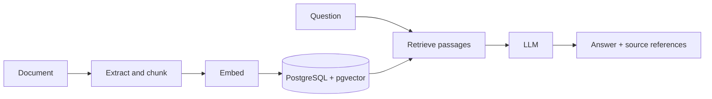

# rag-mtst

**A Python RAG backend you can inspect, modify, and integrate into other applications.**
Index documents, retrieve relevant passages, and generate answers with references
to the text used. This is a developer-oriented backend, not a finished chat product.



The CLI and HTTP API use the same backend functions. A separate ingestion worker
processes durable indexing jobs. PostgreSQL stores chunks, vectors, jobs, and
optional conversation history. The original uploaded files are **temporary
inputs**, not an archive.

**What's included:** TXT/Markdown/PDF/DOCX/PPTX parsing; optional visual
extraction; OpenAI or local embeddings; lexical, cosine, window, and hybrid
search; OpenAI, DeepSeek, Ollama, or Anthropic answers; and a FastAPI interface.

## Quickstart: your first answer

**Requirements:** [uv](https://docs.astral.sh/uv/getting-started/installation/),
Docker with Compose running, and an OpenAI API key. The local manager supports
Linux, macOS, and WSL. The project requires Python 3.14+; uv can manage it.

```bash
git clone https://github.com/richard-costa/rag-mtst.git
cd rag-mtst
uv run rag start
```

On first use, `rag start` creates `.env` if needed and tells you which values
are missing. Set `OPENAI_API_KEY` and `RAG_GENERATION_MODEL` (choose an available
OpenAI model) and run `uv run rag start` again.

It starts **only PostgreSQL in Docker**, runs migrations, and launches the
ingestion worker locally in the background. You don't need to start the API,
activate a virtual environment, or install the CLI separately.

```bash
uv run rag add docs/assets/sample.md
uv run rag search "support hours"
uv run rag ask "When is the support desk open?"
```

You should see an indexed chunk, matching text, then an answer about **Mondays
and Wednesdays, 09:00–12:00**, with a `sample.md` reference. Generated wording
may vary. Hosted embeddings and generation can incur API charges.

```bash
uv run rag status  # Check database and worker
uv run rag stop    # Stop both; indexed data remains
```

Use `uv run rag start` next time to resume. **`uv run rag reset` is destructive:**
it requires confirmation and deletes local indexed data and conversations.

For explanations, expected output, and troubleshooting, use the
[complete quickstart](docs/quickstart.md).

## Explore and extend

| I want to... | Start here |
| --- | --- |
| Understand the components and data flow | [How it works](docs/how-it-works.md) |
| Compare search, change chunking, or adjust prompts | [Experiments](docs/experiments.md) |
| Find the right source file and run tests | [Development guide](docs/development.md) |
| Connect another application over HTTP or Python | [HTTP](docs/reference/http.md) / [Python](docs/reference/python.md) |
| Look up commands and options | [CLI reference](docs/reference/cli.md) |
| Configure another model provider | [Configuration](docs/reference/configuration.md) |
| See the system in a browser (optional) | [Visual demo](demo/README.md) |
| Understand deployment requirements and limitations | [Operations](docs/operations.md) |

The [documentation index](docs/index.md) provides the full reading path.
Future plans are in the [roadmap](ROADMAP.md).

## Project status

**Pre-release; trusted single-tenant backend.** The HTTP API uses one shared
bearer token, not per-user authorization. It is not ready to expose directly to
untrusted public users. The operator/infrastructure team must provide appropriate
networking, TLS, access controls, storage, and operational safeguards. A citation
identifies a supplied passage; it does **not** certify that an answer is correct.
Representative extraction and answer quality have not been established. See
[security and data lifecycle](docs/operations.md).
