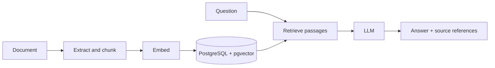

# rag-mtst

**A Python RAG backend you can inspect, modify, and integrate into other applications.**
Index documents, retrieve relevant passages, and generate answers with references
to the text used. This is a developer-oriented backend, not a finished chat product.



The CLI and HTTP API use the same backend functions. A separate ingestion worker
processes durable indexing jobs. PostgreSQL stores chunks, vectors, jobs, and
optional conversation history. The original uploaded files are **temporary
inputs**, not an archive.

**What's included:** TXT/Markdown/PDF/DOCX/PPTX parsing; optional visual
extraction; OpenAI or local embeddings; lexical, cosine, window, and hybrid
search; OpenAI, DeepSeek, Ollama, or Anthropic answers; and a FastAPI interface
for ingestion, search, answers, conversations, and source management.

## Quickstart: your first answer

**Requirements:** [uv](https://docs.astral.sh/uv/getting-started/installation/)
installed **outside** the project's `.venv` (Arch: `sudo pacman -S uv`),
Docker with Compose running, and an OpenAI API key. The local manager supports
Linux, macOS, and WSL. The project requires Python 3.14+; uv can manage it.

```bash
git clone https://github.com/richard-costa/rag-mtst.git
cd rag-mtst
uv run rag start
```

On first use, `rag start` creates `.env` if needed and tells you which values
are missing. Set `OPENAI_API_KEY` and `RAG_GENERATION_MODEL` (choose an available
OpenAI model) and run `uv run rag start` again.

For the default quickstart, `rag start` starts PostgreSQL in Docker, runs
migrations, and launches a host-side ingestion worker. It does **not** start
the HTTP API or the optional DOCX/PPTX converter. You don't need to activate
a virtual environment or install the CLI separately.

```bash
uv run rag add docs/assets/sample.md
uv run rag search "support hours"
uv run rag ask "When is the support desk open?"
```

You should see an indexed chunk, matching text, then an answer about **Mondays
and Wednesdays, 09:00–12:00**, with a `sample.md` reference. Generated wording
may vary. Hosted embeddings and generation can incur API charges.

`uv run rag ...` manages `.venv` without activation. Don't install `uv`
inside `.venv`: uv may recreate it and remove its own executable.

`uv run rag stop` stops the database and worker; indexed data remains. For
expected output, `status`/`reset`, and troubleshooting, use the
[complete quickstart](docs/tutorials/quickstart.md).

## Run commands without `uv run`

Alternatively, from the project root, use Bash/zsh to activate `.venv`:

```bash
uv sync
source .venv/bin/activate
rag start
rag add docs/assets/sample.md
rag ask "When is the support desk open?"
```

Run `uv sync` initially or when dependencies change. In each new shell,
reactivate `.venv`; then use `rag` directly. Finish with `rag stop` and
`deactivate`.

## Visual extraction for DOCX/PPTX

The default `rag add` uses a text parser. For complex layouts,
`--extraction-method visual` renders pages with Poppler and uses a vision
model to extract Markdown for indexing. **For DOCX/PPTX, this requires the
optional LibreOffice/unoserver converter** to turn the document into PDF pages
first; PDFs don't need the converter. Conversion can change page layout.

Install [Poppler](https://pdf2image.readthedocs.io/en/latest/installation.html#installing-poppler)
on the host (Arch: `sudo pacman -S poppler`). In `.env`, set
`RAG_VISUAL_MODEL=gpt-4o` (or another vision-capable model); the default visual
provider is OpenAI, using `OPENAI_API_KEY`. **Run `rag start` first** (or
`uv run rag start` without activation) to launch PostgreSQL and the ingestion
worker; restart it after changing `.env`. For DOCX/PPTX image extraction,
start the converter separately, then submit the document:

```bash
docker compose -p rag-mtst-local up -d office
uv run rag add path/to/complex.docx --extraction-method visual
```

`-p rag-mtst-local` matches the Compose project used by `rag start`. For
independent deployments, use their project name instead (or omit `-p` for the
default). The converter starts once; `rag add` queues work for the running
worker. Add `--reindex` if the file was already indexed. Visual extraction sends page
images to the model provider and may incur costs. See
[provider setup](docs/how-to/providers.md#enable-visual-extraction) and
[limits](docs/reference/limits.md#visual-extraction-bounds).

## Documentation

The [documentation index](docs/index.md) is organized into four sections:

- **[Tutorials](docs/tutorials/quickstart.md)** — the quickstart and hands-on
  [experiments](docs/tutorials/experiments.md).
- **How-to guides** — [ingest and manage sources](docs/how-to/ingest.md),
  [search and ask](docs/how-to/search.md), [conversations](docs/how-to/conversations.md),
  [providers](docs/how-to/providers.md), [develop and test](docs/how-to/develop.md),
  [deploy](docs/how-to/deploy.md), and [troubleshoot](docs/how-to/troubleshoot.md).
- **Reference** — [CLI](docs/reference/cli.md), [HTTP](docs/reference/http.md),
  [Python](docs/reference/python.md), [configuration](docs/reference/configuration.md),
  and [limits](docs/reference/limits.md).
- **Explanation** — [how it works](docs/explanation/overview.md) and the
  architecture, indexing, retrieval, and security deep dives.

An optional [visual demo](demo/README.md) shows the same backend in a browser.
Future plans are in the [roadmap](ROADMAP.md). Contributors can enable optional
[push checks](docs/how-to/develop.md#optional-push-checks).

## Codebase size

Measured with [tokei](https://github.com/XAMPPRocky/tokei) over git-tracked
files, excluding Markdown (2026-11-13):

| Language | Files | Lines | Code | Comments | Blanks |
| --- | ---: | ---: | ---: | ---: | ---: |
| Python | 62 | 13,503 | 11,839 | 213 | 1,451 |
| YAML | 3 | 180 | 174 | 0 | 6 |
| JavaScript | 1 | 141 | 133 | 0 | 8 |
| HTML | 1 | 100 | 98 | 0 | 2 |
| CSS | 2 | 86 | 86 | 0 | 0 |
| TOML | 1 | 67 | 57 | 0 | 10 |
| Dockerfile | 1 | 59 | 39 | 0 | 20 |
| INI | 1 | 39 | 31 | 0 | 8 |
| **Total** | **72** | **14,175** | **12,457** | **213** | **1,505** |

Tokei counts Python docstrings as code. To reproduce:

```bash
git ls-files | grep -v '\.md$' | xargs tokei
```

## Project status

**Pre-release; trusted single-tenant backend.** The HTTP API uses one shared
bearer token, not per-user authorization. It is not ready to expose directly to
untrusted public users. The operator/infrastructure team must provide appropriate
networking, TLS, access controls, storage, and operational safeguards. A citation
identifies a supplied passage; it does **not** certify that an answer is correct.
Representative extraction and answer quality have not been established. See
[security and data lifecycle](docs/explanation/security.md).
