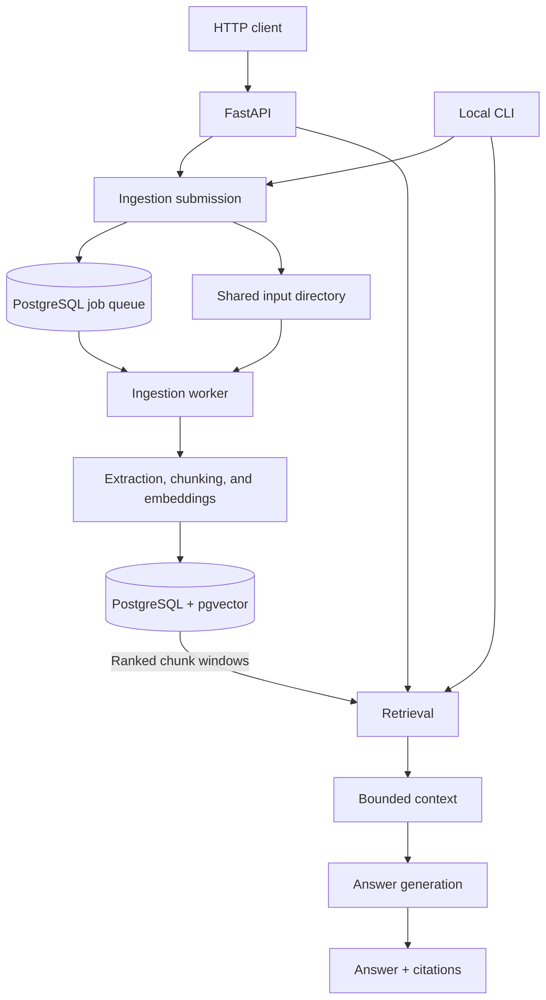
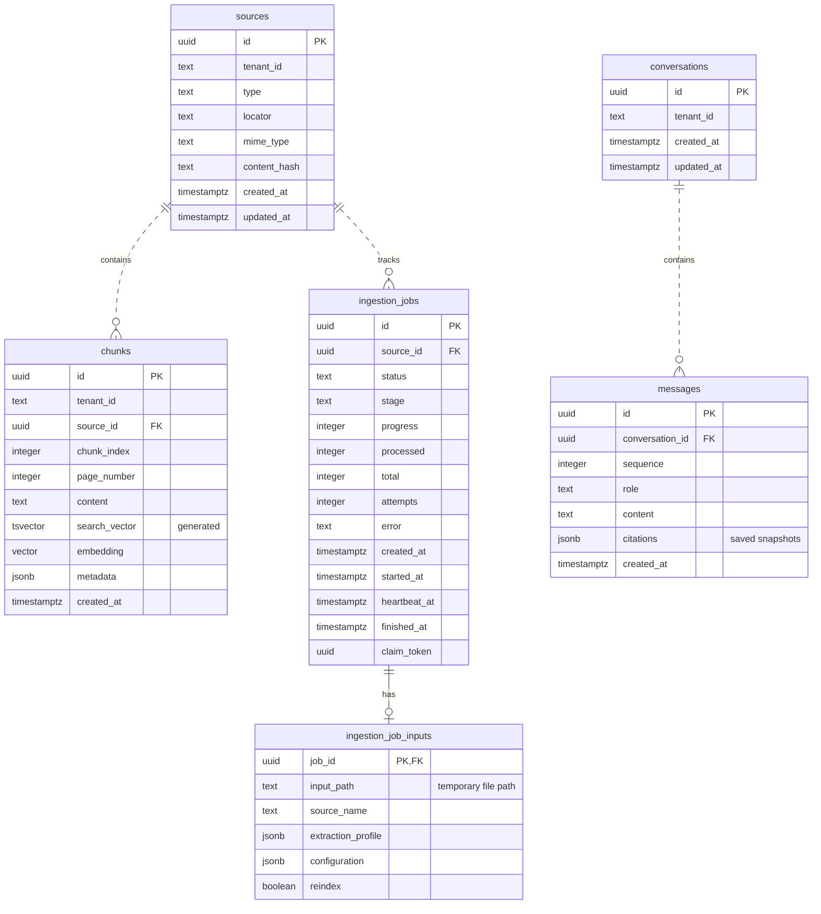
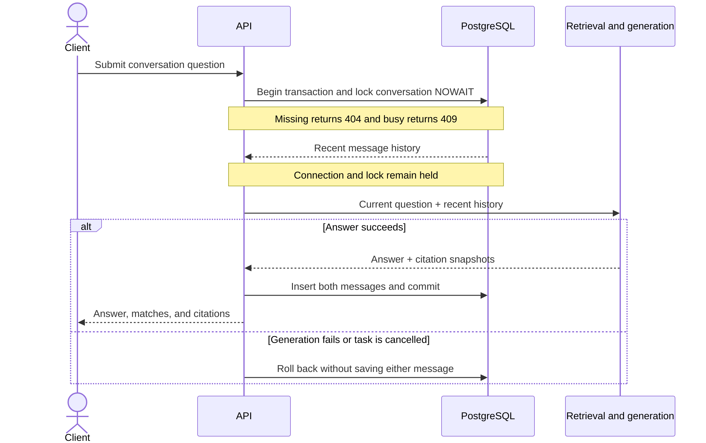

# Architecture

rag-mtst is an async Python application with a PostgreSQL-backed ingestion queue.
HTTP and CLI are adapters over the same feature modules; the CLI does not make
HTTP requests. A separate worker performs durable ingestion. There is no external
queue service, ORM model layer, or service/repository framework.

The API and worker must see the same staging directory at the same path. Only
temporary inputs live there; indexed content lives in the database. Direct Python
indexing functions can execute synchronously within an awaited workflow instead
of submitting a job.

## Ownership

| Module | Responsibility |
| --- | --- |
| `app/api/main.py` | Application factory, authentication, lifespan, and router registration |
| `app/api/routes.py` | HTTP endpoints, feature calls, status translation, and conversation orchestration |
| `app/api/schemas.py` | HTTP request/response models |
| `app/cli.py` | Arguments, direct feature calls, terminal output |
| `app/config.py` | Immutable settings and environment parsing |
| `app/ingestion.py` | Content identity, staging/submission, indexing orchestration |
| `app/worker.py` | Atomic claims, child-process supervision, heartbeats, cleanup |
| `app/extraction/` | Native parsing or explicit page-image transcription; Office conversion when needed |
| `app/chunking.py` | Markdown blocks, sections, packing, provenance |
| `app/embeddings.py` | Hosted/local inference and local token fitting |
| `app/retrieval.py` | Strategy selection, neighboring windows, hybrid fusion |
| `app/generation.py` | Bounded prompts, history, answer/citation validation |
| `app/llm.py` | SDK clients and provider-specific structured-output paths |
| `app/storage/database.py` | Database handle and connection lifecycle |
| `app/storage/records.py` | Shared persistence dataclasses |
| `app/storage/documents.py` | Source/chunk SQL, lexical/vector search, and chunk windows |
| `app/storage/jobs.py` | Job SQL, ownership fencing, and atomic indexing completion |
| `app/storage/conversations.py` | Conversation/history SQL and locked turn transactions |
| `migrations/` | Explicit Alembic schema definitions |

Storage operations are module functions taking a `Database` handle first, not
methods on a shared SQL gateway. Transaction owners keep their boundaries explicit:
job completion inserts chunks on its existing connection, and conversation turns
hold their connection through answer generation. The package split adds no
connection pool or persistence framework.

## Persistence Model

| Table | Stored information |
| --- | --- |
| `sources` | Tenant-scoped content hash, descriptive locator, source identity |
| `chunks` | Indexed text, metadata, vector, generated lexical search vector |
| `ingestion_jobs` | Durable state, progress, ownership, heartbeats, errors |
| `ingestion_job_inputs` | Temporary input paths and nonsecret queued settings |
| `conversations` | Tenant ownership and conversation timestamps |
| `messages` | Ordered user/assistant text and immutable citation snapshots |

The diagram shows all tables and columns; `PK` marks primary keys and `FK`
foreign keys. Each child row belongs to one parent, and all foreign keys use
`ON DELETE CASCADE`. A job can have at most one input record, whose file path
is cleared after terminal-input cleanup.

Composite uniqueness applies to `sources(tenant_id, content_hash)`,
`chunks(source_id, chunk_index)`, and `messages(conversation_id, sequence)`.
A partial unique index also permits only one pending or running job per source.
Citation snapshots are JSONB, not foreign keys to current sources or chunks,
so reindexing does not rewrite past evidence. Nullability, defaults, and check
constraints are defined in `migrations/versions/0001_initial.py`.

Original files are temporary filesystem inputs, not stored in PostgreSQL.
The database stores extracted text chunks, embeddings, and metadata. A locator
is descriptive, not a download endpoint or permanent file path. Unconstrained
pgvector columns allow embeddings of different dimensions; provider/model tags
in metadata separate vector spaces. There is no automatic model revision
tracking or historical embedding index.

`chunks.search_vector` uses PostgreSQL `pg_catalog.simple` and a GIN index;
inserts/replacements update it automatically. Vector search is exact, with no
approximate vector index. Connections are short-lived and unpooled, except that
conversation turns retain a connection and transaction through generation.

## Transaction Boundaries

Indexing prepares the complete replacement before a transaction replaces chunks
and completes the owned job. This protects old search results from failed
reindexing. Claim tokens fence stale workers from committing another owner's job.

A conversation uses a tenant-scoped row lock with immediate conflict detection.
It holds that lock through retrieval/generation and commits the question, answer,
and citation snapshots together. Failures roll back both messages. This is simple
cross-process coordination, but long provider requests also occupy a database
connection and keep that conversation locked.

The diagram follows a turn that acquires the lock. A client timeout is not proof
of task cancellation: the server may still commit. Read history before retrying
an uncertain request; see [conversation recovery](../how-to/conversations.md#handle-overlap-and-uncertain-outcomes).

See [indexing](indexing.md), [retrieval and answers](retrieval.md), and
[security and data lifecycle](../operations.md) for the behavior behind these boundaries.