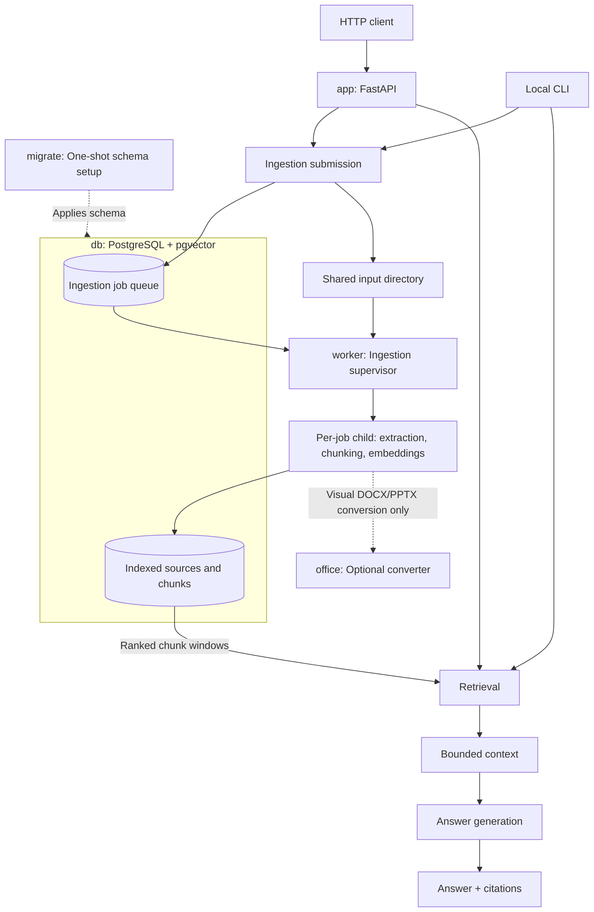
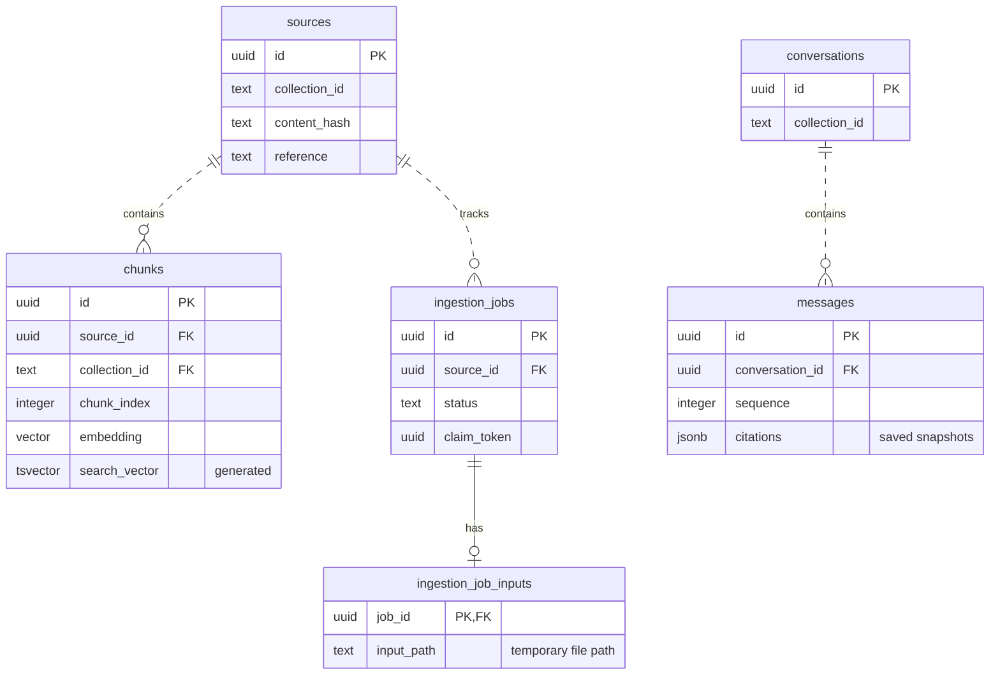
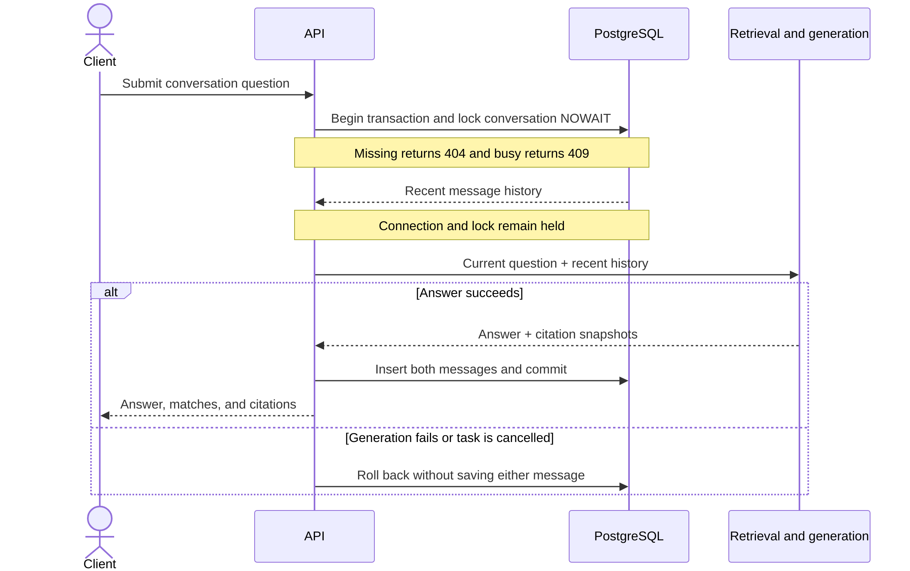

# Architecture and transactions

Implementation boundaries and consistency guarantees. See the [overview](overview.md), [code map](../how-to/develop.md#choose-your-entry-point) and authoritative schema in `migrations/versions/0001_initial.py`.

## Component boundaries

The CLI calls feature functions directly; FastAPI wraps the same functions. PostgreSQL provides storage and the durable queue; a separate worker executes jobs. No broker, ORM or service/repository framework. See [HTTP package boundaries](../how-to/develop.md#http-package-boundaries).

**Local development:** `rag start` manages PostgreSQL in Docker and launches
the worker on the host. Its per-job child processes also run on the host.
The API, when needed, is started separately on the host. The CLI, API, and
worker share the local staging directory.

**Compose reference setup:** `app` (the API) and `worker` run in separate
containers using the same application build configuration. The long-running
worker starts a supervised child process for each claimed ingestion job;
those children run inside the worker container, not the API container.
The API submits durable jobs to PostgreSQL, and both containers access staged
inputs through the shared `rag-data` volume. See
[Compose services](../how-to/deploy.md#compose-services) for the service
inventory, volumes, and startup order.

**Deployed backend:** The API and worker must see staged inputs at the **same
filesystem path**. The infrastructure team owns that shared storage, database
connectivity, process supervision, and ingress. The standard backend image
does not include the educational browser demo.

Python callers can also invoke direct indexing functions without submitting
an asynchronous job. See [indexing details](indexing.md).

## Data and persistence

The diagram shows keys and identifying columns only.

| Table | Purpose |
| --- | --- |
| `sources` | Collection-scoped source identity and descriptive origin reference |
| `chunks` | Extracted text, metadata, embeddings, and indexed search text |
| `ingestion_jobs` | Durable status, progress, ownership, and heartbeats |
| `ingestion_job_inputs` | Temporary file path and nonsecret queued configuration |
| `conversations` | Collection-owned conversation records |
| `messages` | Ordered turns and saved citation snapshots |

These relationships are backed by foreign keys with `ON DELETE CASCADE`.
A job has at most one staged-input record, cleared after terminal input cleanup.
A chunk references its source through the composite key
`(source_id, collection_id) -> sources(id, collection_id)`, so it cannot belong
to a different collection than its source. Collection IDs are nonempty text;
there is no collection table, and jobs inherit their source's collection.
Important uniqueness constraints include `sources(collection_id, content_hash)`,
`chunks(source_id, chunk_index)`, and
`messages(conversation_id, sequence)`. A partial unique index prevents more
than one pending/running job for a source.

Original bytes are not archived. `sources.reference` is descriptive metadata, not an identity or fetch instruction; see the [reference contract](../reference/http.md#search-and-answer-responses). URLs or external IDs can use this column without schema changes. Citation snapshots are JSONB, not live chunk references; reindexing does not change saved evidence.

The vector column can hold different dimensions; provider/model tags separate
embedding spaces. Model revisions or endpoint deployments are **not** tracked
automatically. The generated `chunks.search_vector` uses PostgreSQL's
`simple` text-search configuration with a GIN index. Vector search is exact,
without an approximate-nearest-neighbor index.

## Ingestion guarantees

Submission stages the complete file before committing the source and its
durable job. A worker claims that job with an ownership token and uses
heartbeats to detect lost execution. Stale workers cannot commit another
worker's claimed job. One worker claims jobs from all collections; each job
carries its source's collection through processing and cleanup.

The worker prepares the **entire replacement index** before a transaction
inserts the replacement chunks and marks the owned job completed. A failed
reindex preserves the earlier searchable chunks; failed or interrupted jobs
are not automatically replayed, because provider calls can incur costs.

Database operations receive a `Database` handle explicitly rather than
using a central persistence gateway. Transactions are owned by the workflow
that needs atomicity; the job-completion path writes through its existing
connection. There is no application-wide connection pool.

Source deletion locks the source row, the same lock job submission takes, and
refuses while a job is pending or running or a staged input is still on disk.
The cascade then removes chunks, jobs, and job inputs together, so deletion
never races a worker or orphans a staged file it knows about.

The [indexing internals](indexing.md) cover job stages, extraction profiles,
chunk provenance, cleanup, and failure recovery in more detail.

## Conversation transactions

Each conversation turn acquires a collection-scoped row lock with `NOWAIT`.
A missing or other-collection conversation returns **404**; one already processing
a turn returns **409**. Deletion takes the same lock, so it also returns 409
rather than removing a conversation mid-turn. The lock remains held through
retrieval and model generation, so long provider calls also occupy a database
connection.

Both messages and citation snapshots commit atomically; failure or cancellation rolls back both. See [history budget](retrieval.md#conversations-share-the-same-budget) for retrieval and generation semantics.

**A client timeout is not proof of server cancellation.** A turn may have
committed after the client disconnected. Read history before retrying; see
[conversation recovery](../how-to/conversations.md#handle-overlap-and-uncertain-outcomes).

Continue with [retrieval and answers](retrieval.md) for context-budget and
citation semantics, or [security and data lifecycle](security.md).
