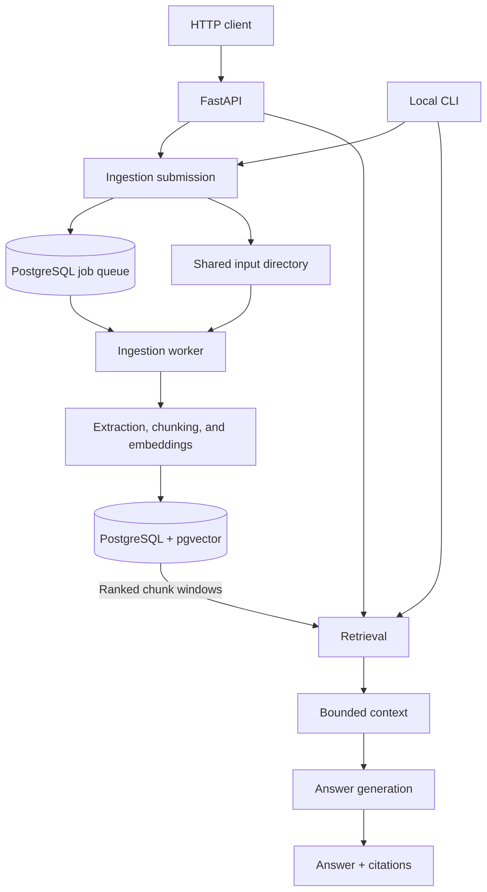
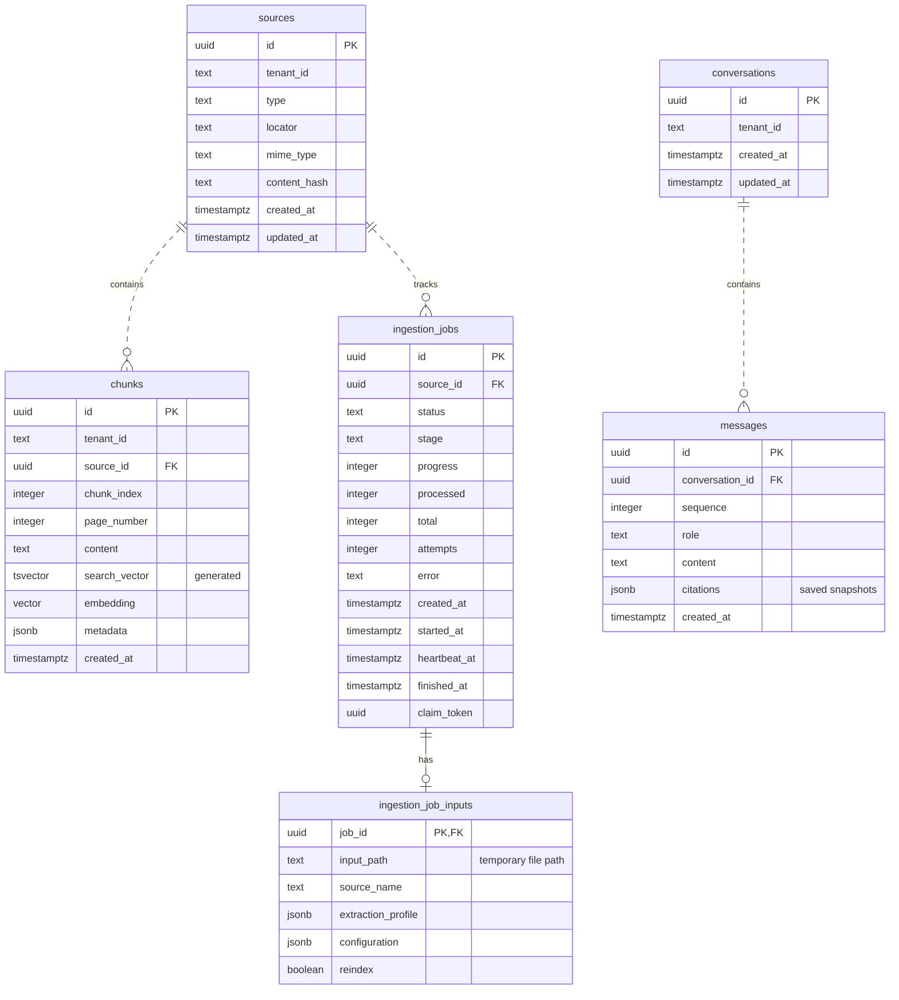
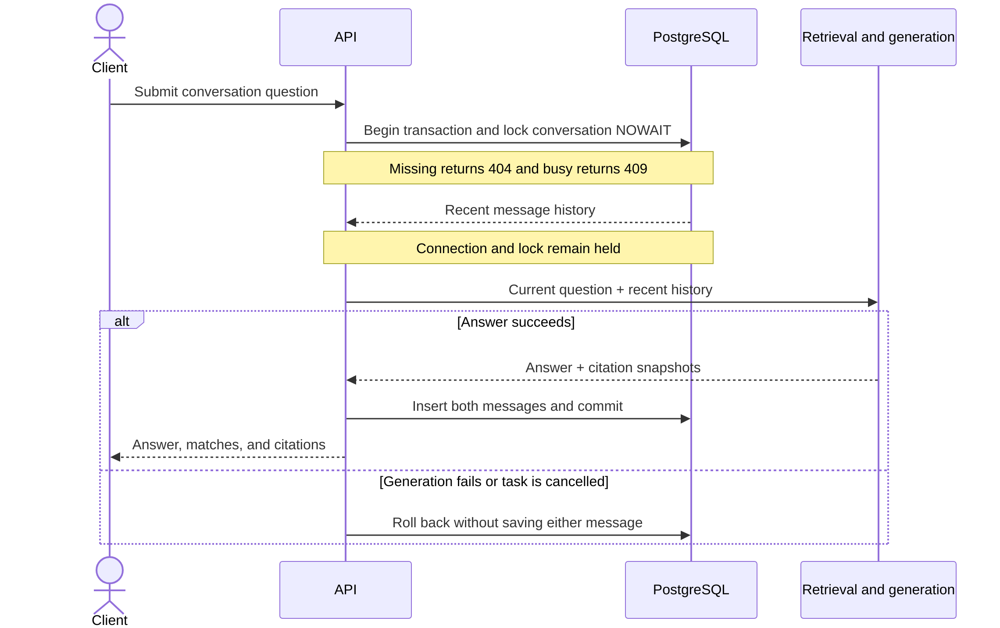

# Architecture and Transactions

This page documents the **implementation boundaries and consistency guarantees**
behind the [conceptual overview](../how-it-works.md). For a directory-by-directory
code map, use the [development guide](../development.md#choose-your-entry-point).
For exact database columns and constraints, the authoritative definition is
`migrations/versions/0001_initial.py`.

## Component Boundaries

The CLI calls application functions **directly**; HTTP clients use FastAPI.
Both operate on the same feature modules and PostgreSQL database. A separate
worker executes durable ingestion jobs. There is no external message broker,
ORM layer, or separate service/repository framework.

**Local development:** `rag start` manages PostgreSQL in Docker and launches
the worker on the host; they share a local temporary directory.

**Deployed backend:** The API and worker must see staged inputs at the **same
filesystem path**. The infrastructure team owns that shared storage, database
connectivity, process supervision, and ingress. The standard backend image
does not include the educational browser demo.

The worker executes ingestion in supervised child processes. Python callers
can also invoke direct indexing functions without submitting an asynchronous
job. See [indexing details](indexing.md).

## Data and Persistence

The schema has six tables with four main relationships:

| Table | Purpose |
| --- | --- |
| `sources` | Tenant-scoped source identity and original locator |
| `chunks` | Extracted text, metadata, embeddings, and indexed search text |
| `ingestion_jobs` | Durable status, progress, ownership, and heartbeats |
| `ingestion_job_inputs` | Temporary file path and nonsecret queued configuration |
| `conversations` | Tenant-owned conversation records |
| `messages` | Ordered turns and saved citation snapshots |

These relationships are backed by foreign keys with `ON DELETE CASCADE`.
A job has at most one staged-input record, cleared after terminal input cleanup.
Important uniqueness constraints include `sources(tenant_id, content_hash)`,
`chunks(source_id, chunk_index)`, and
`messages(conversation_id, sequence)`. A partial unique index prevents more
than one pending/running job for a source.

Original file bytes are **not** archived in PostgreSQL. Source locators describe
the input rather than acting as download URLs. Citation snapshots are JSONB
rather than references to live chunk rows: reindexing does not rewrite
previously recorded conversational evidence.

The vector column can hold different dimensions; provider/model tags separate
embedding spaces. Model revisions or endpoint deployments are **not** tracked
automatically. The generated `chunks.search_vector` uses PostgreSQL's
`simple` text-search configuration with a GIN index. Vector search is exact,
without an approximate-nearest-neighbor index.

For precise fields, nullability, indexes, and constraints, inspect the
[migration definition](https://github.com/richard-costa/rag-mtst/blob/main/migrations/versions/0001_initial.py)
rather than maintaining a second copy of the SQL schema in a diagram.

## Ingestion Guarantees

Submission stages the complete file before committing the source and its
durable job. A worker claims that job with an ownership token and uses
heartbeats to detect lost execution. Stale workers cannot commit another
worker's claimed job.

The worker prepares the **entire replacement index** before a transaction
inserts the replacement chunks and marks the owned job completed. A failed
reindex preserves the earlier searchable chunks; failed or interrupted jobs
are not automatically replayed, because provider calls can incur costs.

Database operations receive a `Database` handle explicitly rather than
using a central persistence gateway. Transactions are owned by the workflow
that needs atomicity; the job-completion path writes through its existing
connection. There is no application-wide connection pool.

The [indexing internals](indexing.md) cover job stages, extraction profiles,
chunk provenance, cleanup, and failure recovery in more detail.

## Conversation Transactions

Each conversation turn acquires a tenant-scoped row lock with `NOWAIT`.
A missing or other-tenant conversation returns **404**; one already processing
a turn returns **409**. The lock remains held through retrieval and model
generation, so long provider calls also occupy a database connection.

Both user and assistant messages, including citation snapshots, commit
together. Failure/cancellation rolls back **both**. The generation history is
bounded context, not citation evidence; retrieval still searches only the
current question.

**A client timeout is not proof of server cancellation.** A turn may have
committed after the client disconnected. Read history before retrying; see
[conversation recovery](../how-to/conversations.md#handle-overlap-and-uncertain-outcomes).

Continue with [retrieval and answers](retrieval.md) for context-budget and
citation semantics, or [operations](../operations.md) for security and recovery.
