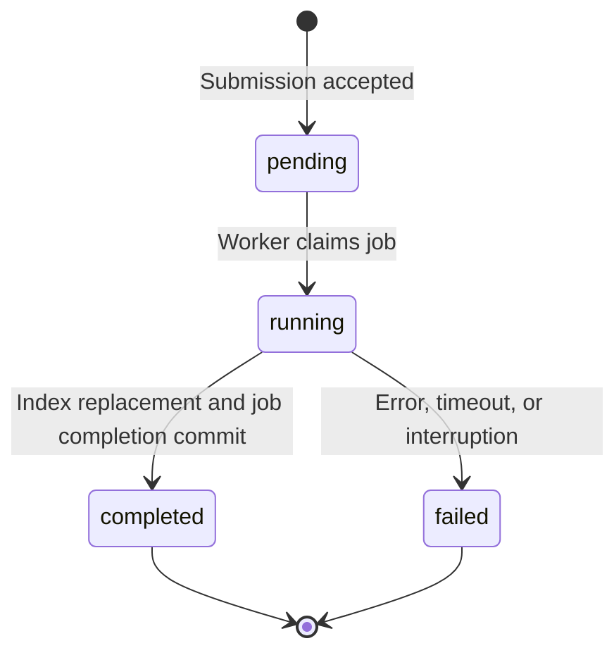

# Extraction and Indexing

## Identity Is Content, Not Filename

Source identity is `(tenant_id, SHA-256(file_bytes))`. Identical bytes in another
tenant are independent; another filename in the same tenant does not create a new
source. Different bytes create a new source rather than a version of the old one.

Byte identity alone is insufficient for reuse. Each chunk also stores an
extraction profile: method, format, engine/version or decoding policy, and visual
model/endpoint/settings where relevant. Missing, conflicting, or mixed profiles
require explicit reindexing. The system does not silently reinterpret old content.

Embedding/chunking changes also require deliberate reindexing; ordinary duplicate
adds do not rebuild old vectors. Reindex keeps the source ID but replaces chunks
and vectors, not a historical index version.

## Extraction Is an Explicit Choice

The default parser decodes text/Markdown and uses AnyDoc for textual PDF, DOCX,
and PPTX. It does not call Office or a hosted vision model on failure. Scanned
PDFs requiring OCR are rejected rather than silently incurring model costs.

Explicit visual extraction renders each PDF page with Poppler and asks a selected
model to transcribe it. Office documents first pass through unoserver PDF
conversion. Blank pages and ordered page/slide numbers are retained. The previous
page's short excerpt can guide continuation, but is not evidence from the current
page. Structured output validates shape, not transcription or heading accuracy.

Native output has no reliable page/slide numbers, so none are fabricated. Visual
transcription supplies known page records. Layout conversion and vision can still
lose information; representative accuracy for scans, charts, tables, and Office
layouts has not been established. See [formats and bounds](../reference/limits.md).

## Structure First, Tokens Second

Markdown is divided into blocks and heading sections, then packed toward a soft
word budget (180 by default), including heading context. Separate sections are
not merged. Adjacent grouping is enabled by default. Oversized prose splits by
sentence and then words; lists split between top-level items. Individual list
items, tables, and fenced code can exceed the structural target.

Chunks retain heading paths and extracted-text body line ranges. Heading context
is prepended without becoming body provenance. When page records are available,
`source_pages` describes the body's kind/start/end and `scope="body"`. Grouping
may span blank pages; inherited headings do not claim those pages as evidence.

Local embedding preparation measures actual tokenizer input, including special
tokens and prompts. Oversized chunks become contiguous slices, even within tables
or code; concatenating them reconstructs the structural chunk exactly. Metadata
adds `parent_chunk_index`, `split_index`, `start_char`, and `end_char` (zero-based,
end-exclusive). Inherited ranges describe `parent_body`, not exact slice pages
or lines. Oversized direct local calls and queries fail before inference. Hosted
input-token budgets are not managed locally.

## Durable Work Without Automatic Replay

Submission writes a complete staged input, then transactionally records the
source, job, extraction profile, and nonsecret settings. Matching active
submissions reuse work; conflicting settings are rejected. Already-indexed
matching sources need no new job. Credentials come from the worker at execution.

These are job statuses. While `running`, progress stages are `extracting`,
`chunking`, `embedding`, and `storing`. Explicit resubmission after failure
creates a new job; a failed job never returns to `pending` automatically.

The worker atomically claims a pending job and executes it in a supervised child
process. Heartbeats detect lost work; execution and shutdown have explicit
[time limits](../reference/limits.md#worker-and-model-context). A stale job fails on
a later poll, rather than automatically replaying potentially paid work.

The complete prepared replacement and job completion commit together. Revoked
claims cannot commit, and failed reindexing preserves the old searchable chunks.
Terminal inputs are removed, with cleanup retried by later polls. If a submission
has an uncertain database outcome, it may leave an unreferenced file rather than
risk deleting an accepted input. There is no general orphan-file sweep.

Operators retry by fixing the cause and submitting the original again, not by
assuming inputs were retained. See [ingestion and recovery](../how-to/ingest.md).