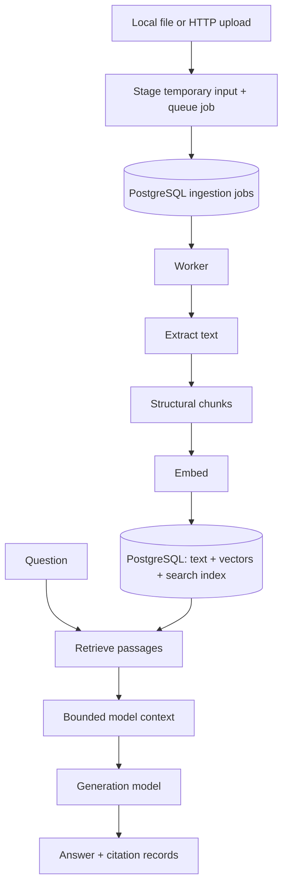

# How RAG-MTST works

Retrieval-augmented generation (RAG) supplies relevant indexed passages to a model as answer context. RAG-MTST exposes the same backend through Python, HTTP and CLI.

## One system, two flows

The API and CLI share feature modules. The separate worker continues ingestion after the submitter exits.

## Ingestion: from file to indexed passages

Files are staged temporarily; tenant-scoped content hashes identify sources. The worker extracts text, creates structural Markdown chunks with provenance, embeds them and stores text/vectors in PostgreSQL. Keep originals separately.

Native parsing is the default; visual extraction is explicit, with no automatic OCR fallback. See [extraction and indexing](indexing.md) for deduplication, atomic reindexing and job recovery.

## Retrieval: select evidence for a question

All strategies are tenant-scoped.

| Method | What it does | Useful for |
| --- | --- | --- |
| `lexical` | PostgreSQL full-text word matching, no embedding request | Exact terms, names, phrases |
| `cosine` | Exact similarity between query embedding and indexed vectors | Paraphrases and related concepts |
| `window` (default) | Cosine matches plus nearby chunks in document order | Recovering context split across chunks |
| `hybrid` | Reciprocal-rank fusion of vector and lexical rankings | Combining exact-term and semantic signals |

Retrieval scores are **not probabilities**. Defaults, window sizing, scoring,
and language behavior are described in
[retrieval and answers](retrieval.md#search-methods). Try them in the
[retrieval experiment](../tutorials/experiments.md#experiment-1-compare-retrieval-strategies).

## Generation: passages become an answer

`rag ask` supplies retrieved passages and the question within a prompt budget. The model returns answer text and citation IDs; only IDs referring to supplied passages are accepted. With no matches, no generation call is made. See [citation semantics](retrieval.md#what-citations-establish).

## Conversations

The HTTP API can persist conversations and citation snapshots. Recent turns
inform **generation**, but retrieval still searches using the **current
question** only. Services that keep their own history can send recent turns to
`/ask` instead; the backend does not store them. The CLI and demo are stateless
for answers. See
[use conversations](../how-to/conversations.md) and
[how history shares the prompt budget](retrieval.md#conversations-share-the-same-budget).

## What persists?

See [data lifecycle](security.md#data-lifecycle) for persisted records and temporary inputs.

## Next steps

Start with the [experiments](../tutorials/experiments.md), then use the
[development code map](../how-to/develop.md#choose-your-entry-point) to locate the
modules behind each part of the pipeline. For transactional and persistence
details, see [architecture and transactions](architecture.md).
