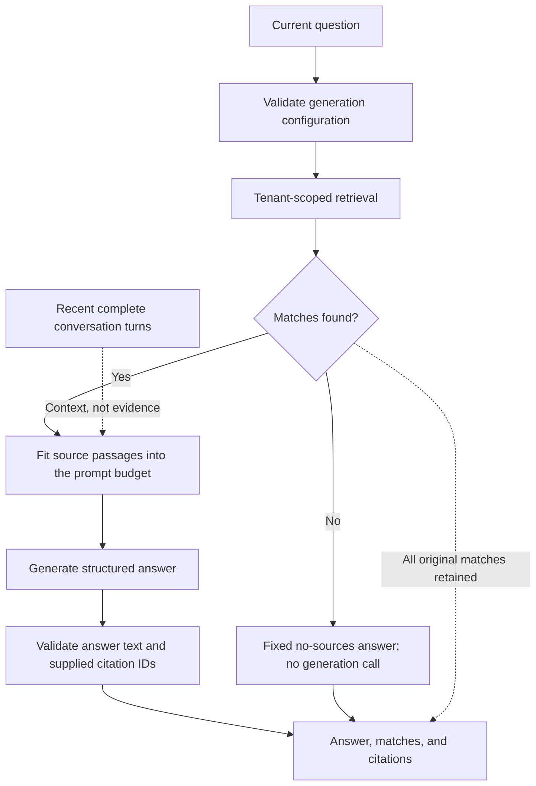

# Retrieval and Answers

## Search Methods

All search is tenant-scoped. The default is `window`, with ten seeds and two
neighbors on each side. Invalid options and provider errors fail explicitly;
there is no silent lexical fallback when embeddings fail.

| Method | Behavior | Score |
| --- | --- | --- |
| `cosine` | Exact pgvector distance, matching provider/model tags; excludes null/zero vectors | `1 - cosine_distance`; no threshold |
| `window` | Cosine seeds plus same-source neighbors by chunk index | Seed score retained; added neighbors have null score |
| `lexical` | PostgreSQL full-text search using `simple` and GIN; no embedding call | `ts_rank_cd(..., 2)`; not BM25 |
| `hybrid` | Equal-weight reciprocal-rank fusion of cosine and lexical candidates | Sum of `1 / (60 + rank)`; no windows |

Windows stop at source boundaries and deduplicate by source ID/chunk index, not
content. Each seed travels with its neighbors in document order. Overlapping
same-source windows merge, and groups retain the priority of their best-ranked
seed. Window zero is equivalent to cosine. With window two, results can reach
five times the seed limit before overlap; each seed performs a neighbor read.

Lexical terms are safely quoted and OR-combined. The language-neutral `simple`
configuration normalizes case, but does not stem, remove stopwords, fold accents,
detect language, or translate. Inflections and accented/unaccented forms can
therefore differ. Lexical retrieval also finds chunks without compatible vectors.

Hybrid embeds the query once and takes `max(20, 4 * limit)` candidates per branch.
Ranks start at one; stable ties use source ID and chunk index. It returns the best
`limit`, not raw scores added across incompatible scales. An empty branch is
allowed; a failed provider call is not. Multilingual semantics come from
embeddings, not fusion. No method's score is a probability, and scores are not
comparable across methods. Reranking is absent; MMR/multi-query stubs are not
selectable strategies.

## Retrieval Is Not the Final Prompt

Answers validate generation configuration, retrieve matches, and fit source
passages into a bounded serialized prompt. The budget includes system text,
question, labels, JSON escaping, history, response schema, and a formatting
reserve. The default is 8000 locally estimated input tokens, using `tiktoken`'s
`cl100k_base` encoding, not exact provider accounting. Passages retain retrieval
order and the final fitting passage may be shortened. The response retains all
original matches, even those not supplied.

With no matches, the application returns a fixed English no-sources message
without calling generation, after configuration validation. There is no excerpt
mode, streaming, automatic generation retry, or provider/model fallback.

## What Citations Establish

The model returns typed `{text, citations}` output. Numeric IDs must belong to
supplied passages; unknown IDs and empty answer text are errors. The structured
citation list is authoritative. Inline references in the answer are optional,
are not parsed, and do not need to duplicate that list. Empty citation lists are
valid, but leave the answer uncited.

Citations expose the exact supplied passage, `source_reference`, chunk index,
and truncation flag. The reference is descriptive origin metadata; file ingestion
currently supplies a filename, not a retained original or download link. It is
not necessarily unique or accessible. Citations let a reader inspect what was
available, not prove that the answer follows from it. JSON encoding and
source-boundary instructions also do not guarantee resistance to prompt injection.

## Conversations Share the Same Budget

Recent conversation messages can help generation interpret a follow-up, but
retrieval still sees only the current query. Ambiguous references can therefore
retrieve poor material. No history summary or query rewriting is performed.

At most ten complete recent turns fit within one third of the existing prompt
budget; older whole turns are omitted. This is not an additional allowance.
History is untrusted context, never evidence, and citation IDs refer only to the
current supplied passages. Successful assistant messages save citation snapshots
so source reindexing does not rewrite past evidence.

See the [HTTP contract](../reference/http.md) and
[conversation workflow](../how-to/conversations.md) for request behavior.