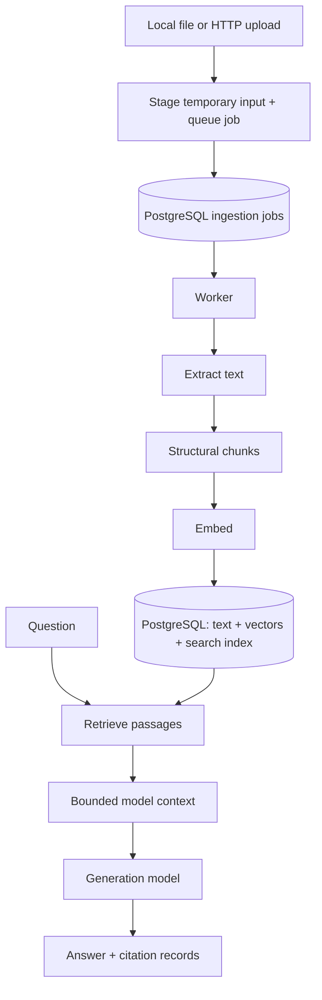

# How RAG-MTST works

RAG means **retrieval-augmented generation**: instead of asking a model to answer
from memory alone, the application finds relevant passages from indexed documents
and supplies them as context for the answer.

RAG-MTST is a reusable **backend**. Other applications can invoke its HTTP API
or Python functions; the CLI is a convenient direct interface for local use.

## One system, two flows

The API and CLI share feature modules. They do not implement separate search or
answer engines. The ingestion worker is a **separate process** so work can continue
after the client that submitted it exits.

## Ingestion: from file to indexed passages

1. A file is submitted by `rag add` or authenticated HTTP upload.
2. Its bytes are copied to a **temporary staging directory**. The source is
   identified by its content hash within the configured tenant.
3. PostgreSQL records a durable job and its nonsecret indexing settings.
4. A worker claims the job and extracts TXT/Markdown/PDF/DOCX/PPTX text.
5. The extracted text is split into **structural Markdown chunks**, preserving
   section headings and available provenance.
6. Each chunk is embedded: converted into a vector representing its content.
7. Chunks, metadata, vectors, and full-text search fields are stored in PostgreSQL.
8. The completed/failed staged input is cleaned up. The original file must be
   kept separately.

Default extraction is native parsing. **Visual extraction** is explicit, uses
a configured vision model and page rendering, and may send page images to a
provider. No automatic OCR fallback is performed.

Indexing jobs are durable; worker failure does not silently re-run paid work.
Reindexing explicitly replaces all chunks atomically, preserving the old index
if replacement fails. Identical bytes ordinarily reuse an already indexed source.

## Retrieval: select evidence for a question

All strategies are tenant-scoped.

| Method | What it does | Useful for |
| --- | --- | --- |
| `lexical` | PostgreSQL full-text word matching, no embedding request | Exact terms, names, phrases |
| `cosine` | Exact similarity between query embedding and indexed vectors | Paraphrases and related concepts |
| `window` (default) | Cosine matches plus nearby chunks in document order | Recovering context split across chunks |
| `hybrid` | Reciprocal-rank fusion of vector and lexical rankings | Combining exact-term and semantic signals |

`window` defaults to ten seed chunks and two neighbors on each side. Window
results can exceed the seed limit. `hybrid` does not automatically add windows.
Lexical search uses the PostgreSQL `simple` configuration, not stemming or
language translation. Retrieval scores are **not probabilities** and should not
be compared across strategies.

See the hands-on [retrieval experiment](experiments.md#experiment-1-compare-retrieval-strategies)
and the [CLI flags](reference/cli.md).

## Generation: passages become an answer

`rag ask` first retrieves passages, then fits selected passages into a bounded
prompt with the user's question. A configured LLM generates structured output
containing answer text and citation IDs.

The system validates that returned citation IDs refer to passages actually
supplied to the model. It does **not** independently verify the truth of the
model's claims. Some retrieved passages may be excluded or shortened by the
context budget; the result retains original retrieval matches.

With no matches, generation returns a fixed no-sources answer rather than
inventing document evidence. Provider errors are not silently converted into
answers from another model.

## Conversations

The HTTP API can persist conversations and citation snapshots. Recent turns
inform **generation**, but retrieval still searches using the **current
question** only; it does not rewrite ambiguous follow-up questions. Concurrent
turns for the same conversation are rejected rather than running simultaneously.

The CLI and demo are stateless for answers. See the
[HTTP reference](reference/http.md) for conversation endpoints.

## What persists?

PostgreSQL stores source metadata, extracted chunks, embeddings, ingestion jobs,
conversations, and citation snapshots. Temporary upload bytes are staged on disk
and removed after a terminal job. The source locator is descriptive, not a
permanent download link. Backups, retention, and external exposure are operator
responsibilities; see [operations](operations.md).

## Next steps

Start with the [experiments](experiments.md), then use the
[development code map](development.md#choose-your-entry-point) to locate the
modules behind each part of the pipeline. For transactional and persistence
details, see [architecture and transactions](explanation/architecture.md).
